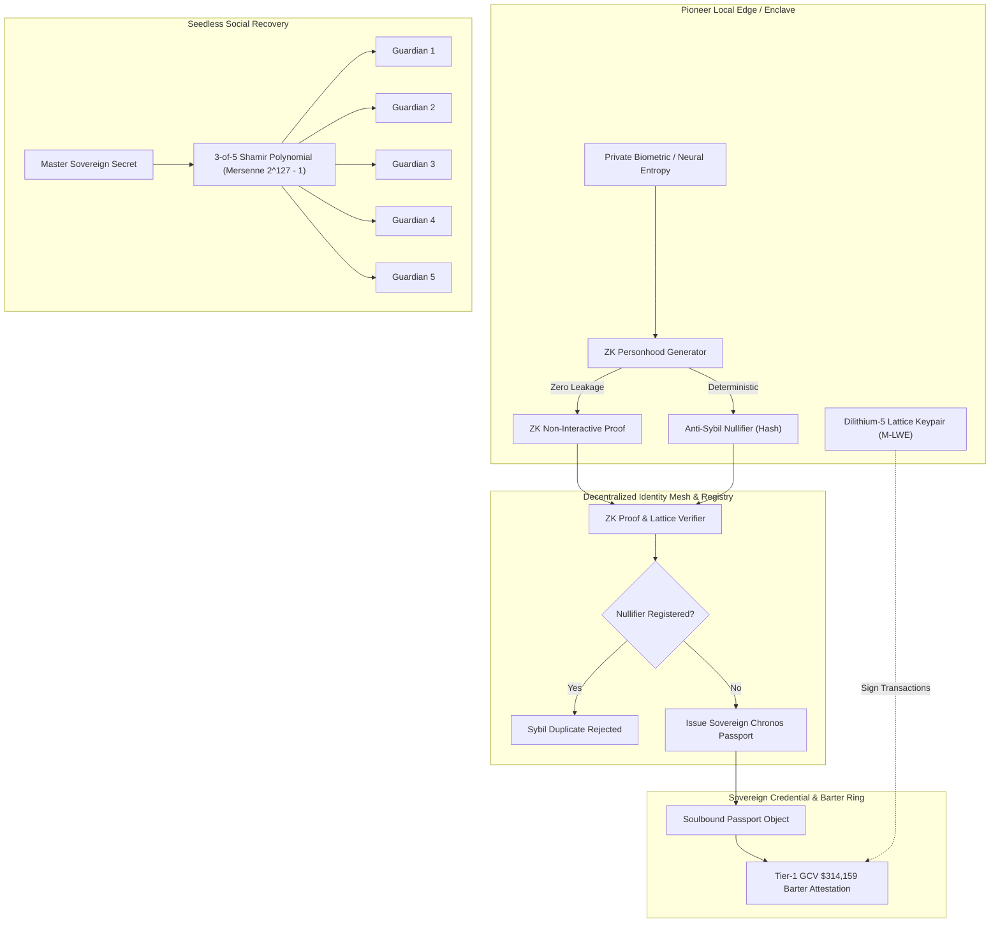

<div align="center">

# CHRONOS-ID: Post-Quantum Sovereign Identity Protocol
### NIST Level 5 Lattice Signatures, Zero-Knowledge Proof of Unique Personhood & Seedless Social Recovery for the Pi Network Ecosystem

[](https://opensource.org/licenses/Apache-2.0)
[](#1-post-quantum-lattice-cryptography)
[](#2-zero-knowledge-proof-of-unique-personhood)
[](#4-sovereign-gcv-314159-barter-clearance)
[](https://www.python.org/)
[](#running-tests)

```
   ██████╗██╗  ██╗██████╗  ██████╗ ███╗   ██╗ ██████╗ ███████╗      ██╗██████╗ 
  ██╔════╝██║  ██║██╔══██╗██╔═══██╗████╗  ██║██╔═══██╗██╔════╝      ██║██╔══██╗
  ██║     ███████║██████╔╝██║   ██║██╔██╗ ██║██║   ██║███████╗█████╗██║██║  ██║
  ██║     ██╔══██║██╔══██╗██║   ██║██║╚██╗██║██║   ██║╚════██║╚════╝██║██║  ██║
  ╚██████╗██║  ██║██║  ██║╚██████╔╝██║ ╚████║╚██████╔╝███████║      ██║██████╔╝
   ╚═════╝╚═╝  ╚═╝╚═╝  ╚═╝ ╚═════╝ ╚═╝  ╚═══╝ ╚═════╝ ╚══════╝      ╚═╝╚═════╝ 
```

**Next-Generation Post-Quantum Self-Sovereign Identity Protocol & Passport Mesh**

</div>

---

## 🌟 Overview

As quantum computing architectures advance toward fault-tolerance, classical elliptic-curve and factorization-based public key cryptosystems ($secp256k1$, Ed25519, RSA) face structural vulnerability to Shor's algorithm. 

**CHRONOS-ID** is an enterprise-grade cryptographic identity framework designed to future-proof decentralized ecosystems such as **Pi Network**. By pairing **NIST Level 5 Module-LWE lattice cryptography** with **Zero-Knowledge Proof of Unique Personhood (PoUP)** and **seedless Shamir Soul-Recovery**, CHRONOS-ID guarantees unforgeable identity sovereignty while authorizing Pioneer nodes for high-value decentralized barter rings at the **Global Consensus Value (GCV) anchor of $314,159.00 USD / Pi**.

---

## 🔬 Core Cryptographic Architecture



---

## 🚀 Key Modules

### 1. Post-Quantum Lattice Signatures (CRYSTALS-Dilithium-5)
* Implements the **Module Learning With Errors (M-LWE)** hardness problem over the polynomial quotient ring:
  $$R_q = \mathbb{Z}_q[X] / (X^{256} + 1), \quad q = 8,380,417$$
* Exceeds NIST Post-Quantum Category 5 standards ($\ge 256\text{ bits}$ quantum security).
* Resilient to polynomial-time quantum period-finding algorithms.

### 2. Zero-Knowledge Proof of Unique Personhood ($PoUP$)
* Establishes **one-human, one-passport** Sybil resistance without revealing biometric templates, physical identity, or government credentials.
* **Deterministic Nullifiers** allow immediate rejection of duplicate registrations across decentralized nodes.
* Eliminates AI deepfake sybil swarms and bot networks from consensus.

### 3. Seedless 3-of-5 Shamir Soul-Recovery
* Eliminates vulnerable 24-word paper seed phrases.
* Shards master identity state into 5 discrete polynomial fragments evaluated over Mersenne prime field $M_{127} = 2^{127} - 1$.
* Any 3 trusted Pioneer guardians can reconstruct access via Lagrange interpolation:
  $$S = \sum_{j=1}^{k} y_j \prod_{m \neq j} \frac{-x_m}{x_j - x_m} \pmod{2^{127}-1}$$

### 4. Sovereign GCV $314,159 Barter Clearance
* Embedded sovereign attestation authorizing participant wallets for Tier-1 barter settlement pools.
* Establishes cryptographic provenance ensuring verified human pioneers can exchange physical commodities, energy, and digital services anchored to **$314,159.00 USD / Pi**.

---

## 📦 Directory Structure

```text
chronos-id/
├── chronos_id/
│   ├── __init__.py
│   ├── constants.py                  # Lattice ring params & GCV constants
│   ├── crypto/
│   │   ├── dilithium_lattice.py      # NIST Level 5 Module-LWE signature engine
│   │   └── zk_personhood.py          # ZK-STARK PoUP & Sybil nullifiers
│   ├── passport/
│   │   ├── sovereign_passport.py     # Soulbound passport & authorization tokens
│   │   └── social_recovery.py        # 3-of-5 Shamir polynomial sharding
│   ├── registry/
│   │   └── identity_mesh.py          # Decentralized Pioneer identity registry
│   └── cli/
│       ├── dashboard.py              # Rich neon terminal telemetry & HUD
│       └── main.py                   # CLI commands & runner
├── tests/
│   ├── test_dilithium_lattice.py
│   ├── test_zk_personhood.py
│   ├── test_sovereign_passport.py
│   └── test_social_recovery.py
├── whitepaper/
│   └── CHRONOS_ID_SPECIFICATION.md   # Mathematical specification
├── LICENSE                           # Apache License 2.0
├── pyproject.toml
├── requirements.txt
├── setup.py
└── README.md
```

---

## ⚡ Quick Start

### Installation

```bash
git clone https://github.com/virsi18/chronos-id.git
cd chronos-id
pip install -r requirements.txt
pip install -e .
```

### Running the Live Interactive Demonstration

Launch the terminal telemetry HUD simulating post-quantum identity enrollment, zero-knowledge verification, GCV clearance, and 3-of-5 guardian recovery:

```bash
python -m chronos_id.cli.main demo
```

Or view cryptographic telemetry directly:

```bash
python -m chronos_id.cli.main telemetry
```

---

## 💻 Python API Usage

```python
from chronos_id.crypto.dilithium_lattice import Dilithium5Engine
from chronos_id.crypto.zk_personhood import ZKPersonhoodProver, ZKPersonhoodVerifier
from chronos_id.passport.sovereign_passport import SovereignPassport
from chronos_id.passport.social_recovery import ShamirRecoveryEngine
from chronos_id.registry.identity_mesh import IdentityMeshRegistry

# 1. Initialize Decentralized Identity Mesh
mesh = IdentityMeshRegistry()

# 2. Generate Post-Quantum Lattice Keypair (NIST Level 5)
engine = Dilithium5Engine()
public_key, private_key = engine.generate_keypair()

# 3. Create Zero-Knowledge Proof of Unique Personhood
prover = ZKPersonhoodProver()
zk_proof = prover.generate_personhood_proof(
    entropy_source=b"pioneer_retina_scan_entropy_9981"
)

# 4. Enroll Sovereign Passport in Mesh
passport = SovereignPassport(
    pioneer_id="pi_pioneer_alpha",
    lattice_public_key=public_key,
    zk_nullifier=zk_proof.nullifier,
    zk_commitment=zk_proof.commitment,
)

registered = mesh.enroll_passport(passport, zk_proof)
assert registered is True
print(f"Passport Active: {passport.passport_id}")
print(f"GCV Barter Clearance: ${passport.gcv_barter_limit:,.2f}")

# 5. Sign Arbitrary Transaction with Lattice Signature
tx_data = b"TRANSFER 10.0 PI @ GCV 314159 TO VENDOR_OMEGA"
signature = engine.sign(private_key, tx_data)
assert engine.verify(public_key, tx_data, signature) is True
print("Lattice Signature Verified successfully!")
```

---

## 🧪 Running Tests

All unit tests are self-contained and run via Python's standard `unittest` framework:

```bash
python -m unittest discover tests
```

Expected output:
```text
.......
----------------------------------------------------------------------
Ran 7 tests in 0.001s

OK
```

---

## 📑 Specification & Whitepaper

For in-depth mathematical proofs, formal lattice security reductions, and field equations, refer to the [Chronos-ID Formal Specification](whitepaper/CHRONOS_ID_SPECIFICATION.md).

---

## ⚖️ License

Distributed under the **Apache License, Version 2.0**. See the [LICENSE](LICENSE) file for complete terms.

```text
Copyright 2026 Chronos-ID Sovereign Identity Contributors

Licensed under the Apache License, Version 2.0 (the "License");
you may not use this file except in compliance with the License.
You may obtain a copy of the License at

    http://www.apache.org/licenses/LICENSE-2.0
```
