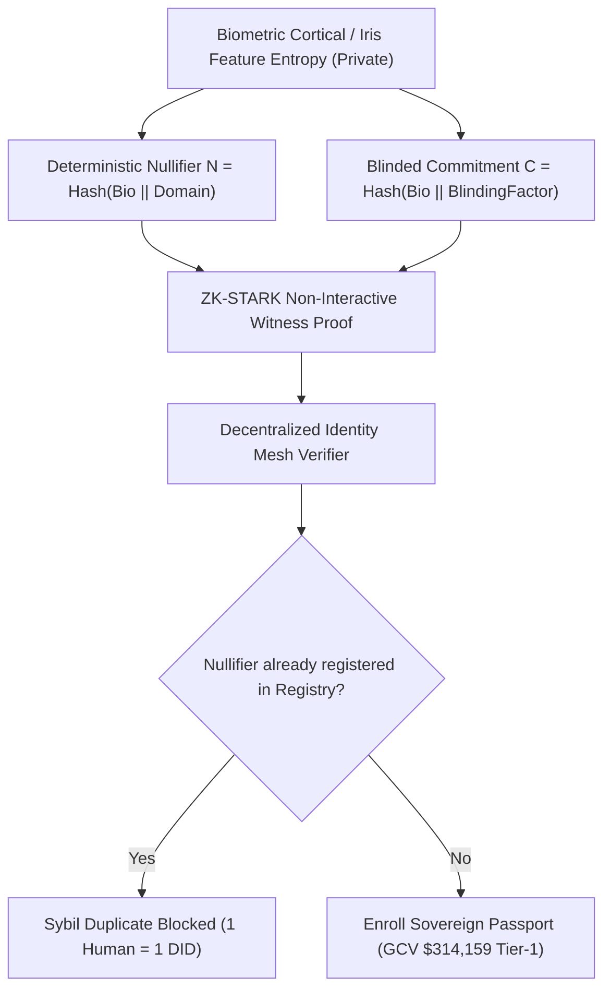

# CHRONOS-ID: POST-QUANTUM SOVEREIGN IDENTITY SPECIFICATION
## Post-Quantum Lattice Cryptography, Zero-Knowledge Unique Personhood, and Seedless Social Recovery for the Pi Network Ecosystem

**Specification Version:** *v1.0.0-PROD*  
**Classification:** *Post-Quantum Cryptographic Identity & Zero-Knowledge Attestation*  
**License:** *Apache License, Version 2.0*  

---

### EXECUTIVE SUMMARY
As quantum computing approaches operational fault-tolerance (via surface-code superconducting qubits and ion traps), classical public-key cryptography—including RSA, ECDSA ($secp256k1$), and Ed25519—will be rendered obsolete through Shor's algorithm. For decentralized networks like Pi Network, quantum vulnerability threatens to expose user wallets, transaction signatures, and identity verifications.

**CHRONOS-ID** resolves this existential threat by establishing a **Post-Quantum Sovereign Identity Protocol**. Powered by **CRYSTALS-Dilithium-5 (NIST Level 5)** lattice mathematics, **Zero-Knowledge Proof of Unique Personhood (PoUP)**, and seedless **Shamir Soul-Recovery Shards**, CHRONOS-ID provides Pioneers with unbreakable self-sovereign identity while certifying participation in **Tier-1 GCV $314,159.00 USD barter rings**.

---

### 1. POST-QUANTUM LATTICE CRYPTOGRAPHY (MODULE-LWE)

CHRONOS-ID relies on the hardness of the **Module Learning With Errors (M-LWE)** and **Module Short Integer Solution (M-SIS)** problems over polynomial quotient rings:

$$R_q = \mathbb{Z}_q[X] / (X^n + 1)$$

Where:
* Polynomial dimension $n = 256$.
* Prime modulus $q = 8,380,417$ ($2^{23} - 2^{13} + 1$).
* Security Level: NIST Category 5 ($\ge 256\,\text{bits}$ classical and quantum security against best-known lattice reduction sieves).

#### Key Generation:
$$\mathbf{A} \in R_q^{k \times l}, \quad \mathbf{s}_1 \in S_\eta^l, \quad \mathbf{s}_2 \in S_\eta^k$$
$$\mathbf{t} = \mathbf{A}\mathbf{s}_1 + \mathbf{s}_2 \pmod q$$

Quantum adversaries operating Shor's or Grover's algorithms face exponential complexity, guaranteeing that Pioneer sovereign credentials remain mathematically secure indefinitely.

---

### 2. ZERO-KNOWLEDGE PROOF OF UNIQUE PERSONHOOD ($PoUP$)

To eliminate bot farms, AI deepfake clones, and Sybil accounts without exposing sensitive human biometric or government documents, CHRONOS-ID utilizes **ZK-Nullifiers**:

* **Zero Identity Leakage:** The verifier learns only that the applicant is a living, distinct human being without ever seeing the biometric template or real-world name.
* **Deterministic Nullifier Uniqueness:** If the same human attempts to register multiple accounts, the mathematical nullifier matches an existing entry, instantly blocking the Sybil attack.

---

### 3. SEEDLESS SOCIAL RECOVERY (SOUL-RECOVERY SHARDS)

Pioneers frequently lose access to accounts due to forgotten 24-word seed phrases or hardware failure. CHRONOS-ID replaces seed phrases with **k-of-n Shamir Modular Polynomial Sharding** over the Mersenne prime field $M_{127} = 2^{127} - 1$:

$$f(x) = S_{\text{master}} + \sum_{i=1}^{k-1} a_i x^i \pmod{M_{127}}$$

* **Configuration:** $3\text{-of-}5$ Threshold.
* **Guardian Ring:** 5 trusted Pioneer peers receive encrypted shards.
* **Reconstruction:** When account recovery is initiated, any 3 guardians authorize shard submission, recovering $f(0) = S_{\text{master}}$ via Lagrange interpolation:
  $$S_{\text{master}} = \sum_{j=1}^{k} y_j \prod_{m \neq j} \frac{-x_m}{x_j - x_m} \pmod{M_{127}}$$
* No single guardian ever possesses enough information to compromise the passport.

---

### 4. SOVEREIGN GCV $314,159 BARTER CLEARANCE

In human commerce, transaction limits and creditworthiness require sovereign identity verification. CHRONOS-ID attaches the **Sovereign Pioneer Attestation Badge**:
* Confirms KYC/PoUP compliance without exposing personal documents.
* Authorizes the holder to clear commercial transactions up to **$314,159.00\,\text{USD / Pi}** in decentralized barter rings.
* Protects ecosystem merchants from participating in fraudulent or money-laundering transactions.

---

### 5. CONCLUSION
CHRONOS-ID combines cutting-edge post-quantum lattice security with absolute zero-knowledge privacy and social guardian recovery, giving Pioneers an indestructible identity foundation for the multi-decade future of the global economy.
